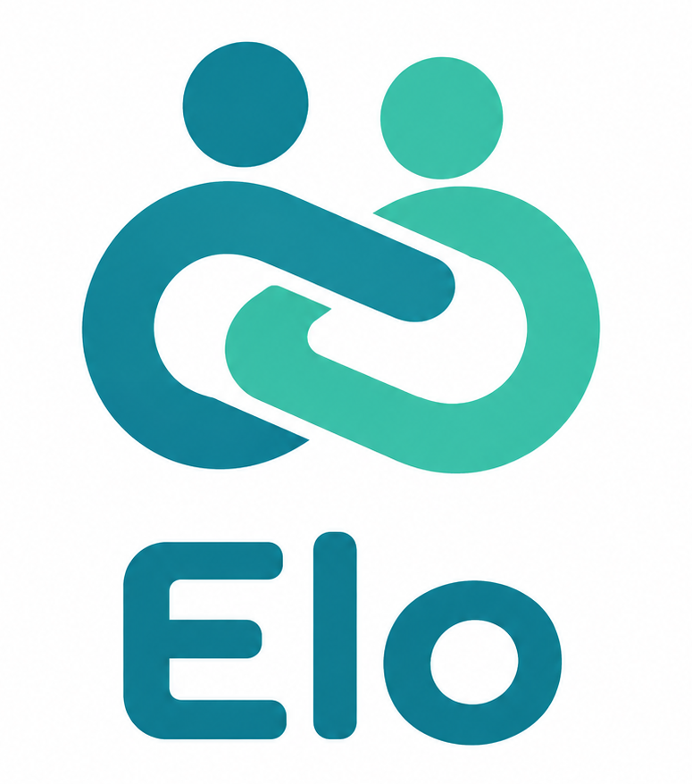

<p align="center">
  
</p>

<h1 align="center">Sistema Elo</h1>

<p align="center">
  <strong>Sistema Web de Gerenciamento para Casas de Acolhimento</strong>
</p>

<p align="center">
  
  
  
  
</p>

---

## Sobre o Projeto

O **Sistema Elo** é uma aplicação web desenvolvida para centralizar e organizar a rotina administrativa, financeira e assistencial de **casas de acolhimento**. A plataforma oferece controle de acesso granular por perfis, gestão de equipe e voluntários (com foto e emissão de crachás), mapa interativo de escala de plantões, agenda institucional integrada, controle de documentos e certidões com alertas de vencimento, livro de plantão com mural de avisos, trilha de auditoria centralizada com espelhamento em `.log`, gestão financeira completa (incluindo metas orçamentárias e recibos de doação), acompanhamento de acolhidos, fichas médicas, ocupação de leitos e geração de relatórios personalizados em PDF.

---

## Tecnologias Utilizadas

- **Back-end:** PHP 8.1+ com PDO (`utf8mb4`, prepared statements e transações SQL)
- **Banco de Dados:** MySQL / MariaDB (`db_elo`, engine `InnoDB`)
- **Front-end:** HTML5, Tailwind CSS (CDN com tema personalizado), JavaScript Vanilla (ES6+), Google Fonts (*Poppins*) e Phosphor Icons
- **Geração de PDF:** [Dompdf](https://github.com/dompdf/dompdf) (`^3.1`) via Composer
- **Integrações Externas:** API [ViaCEP](https://viacep.com.br/) para preenchimento automático de endereços

---

## Funcionalidades Implementadas

### Segurança, Autenticação e Controle de Acesso (RBAC)

- **Autenticação segura:** login com validação via `password_hash`/`password_verify`, cookies `HttpOnly` + `SameSite=Lax` e proteção **CSRF** em todas as requisições POST.
- **Sessões isoladas por aba:** controle de sessão individual por aba (`tabToken` + `BroadcastChannel`), evitando conflitos entre abas simultâneas.
- **Gestão de sessão e senhas:**
  - Tempo de expiração de sessão configurável por usuário (30 a 180 minutos), com renovação controlada.
  - Política de senha forte (mínimo de 8 caracteres com letra maiúscula, minúscula, número e caractere especial).
  - Suporte a bloqueio de conta, ativação/inativação e troca obrigatória de senha no acesso.
- **Permissões granulares (RBAC):** controle de acesso por módulo e por tela armazenado em JSON (`tbPerfilAcesso`), com perfil protegido de **Administração Global**.
- **Navegação inteligente:** menu lateral gerado dinamicamente conforme as permissões do perfil, com busca em tempo real (sem distinção de acentos).
- **Pesquisa e paginação global:** todas as abas de pesquisa dos CRUDs contam com filtro instantâneo e barra de paginação configurável (`10`, `25`, `50` ou `100` registros por página), além de comboboxes com autocomplete AJAX nas seleções de alto volume.
- **Auditoria global automática:** além dos carimbos de criação e alteração em cada cadastro/movimentação, o sistema possui um motor de **auditoria centralizada** (`tbLogAuditoria` + espelhamento em `.log`) que captura automaticamente eventos de segurança, criações, edições, exclusões e exportações em PDF de **todos os módulos atuais e futuros**.
- **Configurações Pessoais, Instituição e Tema (Engrenagem):** menu global presente em todas as barras superiores com **Alterar Senha**, **Informações da Instituição** (CNPJ, razão social, nome fantasia, contato e endereço via ViaCEP, usados em crachás e recibos) e **Aparência e Tema** (**Tema Claro** e **Tema Escuro** salvos individualmente por login, sem flash na navegação e com proteção automática para impressão e crachás).

---

### Módulo Geral

- **Dashboard**
  - **Dashboard Geral:** visão executiva integrada com layout dinâmico em duas colunas, indicadores de acolhidos ativos, ocupação de leitos, equipe/voluntários, pendências do plantão, usuários e alertas de segurança, **Plantonistas de Hoje**, **Próximos Eventos da Agenda** (com destaque automático *"Você está envolvido"* para o usuário logado vinculado a colaborador), alertas de **Documentos e Certidões** (vencidos / vencendo em breve), mural de avisos fixados, atividade recente de auditoria posicionada dinamicamente logo abaixo do mural, resumo financeiro do mês (respeitando permissões) e atalhos rápidos.
- **Cadastros**
  - **Usuários:** inclusão, edição, ativação/inativação, bloqueio de acesso, definição de perfil, troca forçada de senha e tempo de expiração da sessão.
  - **Perfis de Acesso:** gerenciamento completo de perfis com matriz de permissões por módulo, categoria e tela (com seleção em lote por módulo).
  - **Colaboradores e Voluntários:** cadastro da equipe da instituição (colaboradores, voluntários, estagiários e terceirizados) com validação de CPF, upload de foto ou captura por webcam em diretório privado (`uploads/colaboradores/`), cargo/função, registro profissional, turno, endereço via ViaCEP, vínculo opcional com usuário do sistema e **Emissão de Crachá de Identificação Funcional** em modal na mesma aba — padrão CR80 (`54 × 86 mm`) com modos para **Impressora Caseira A4 (frente/verso dobrável)**, **Papel Adesivo (2× frente)** e **PDF para Gráfica (CR80 + 3 mm de sangria e marcas de corte via Dompdf)**.
  - **Documentos e Certidões Institucionais:** controle de documentos obrigatórios (alvarás, AVCB, CMAS/CMDCA, CNDs, estatuto, atas e convênios) com anexo privado (PDF/imagem até 10 MB), visualizador em modal na mesma aba, opção de documento permanente, prazo configurável de alerta, status automático (**Válido**, **Vencendo em breve**, **Vencido**, **Desatualizado**), fluxo guiado **Renovar** (marca automaticamente a versão anterior como *Desatualizado* ao subir a nova via) e alternância rápida em 1 clique para remover documentos antigos dos alertas.
- **Movimentações**
  - **Escala de Plantões:** mapa visual interativo (visão **Semanal Turnos × Dias** e **Mensal**) com dock lateral da equipe ativa, **arrastar e soltar (drag-and-drop)** para alocar ou mover plantões, edição de status/horários/observações, detecção de turnos descobertos e conflitos no mesmo dia, cópia da semana anterior em 1 clique e impressão em A4 paisagem para mural.
  - **Agenda Institucional:** calendário mensal interativo com clique/duplo-clique no dia, **drag-and-drop** para reagendar eventos, pauta lateral do dia, seletor visual com fotos para vincular múltiplos participantes (colaboradores, voluntários, estagiários e terceirizados), filtros por categoria/"Meus eventos", impressão A4 paisagem e exibição personalizada no Dashboard Geral.
  - **Livro de Plantão e Avisos:** registro de passagens de turno, ocorrências e avisos gerais com mural de avisos fixados no topo, prioridade, acompanhamento de status/resolução, vínculo opcional com colaborador e acolhido via autocomplete, filtros e impressão/PDF da folha de plantão.
  - **Log de Auditoria (Global):** trilha centralizada com captura automática de **todos os módulos existentes e futuros**, filtro dinâmico de módulos, cards de resumo, filtros combinados (incluindo combobox de usuário com autocomplete AJAX), paginação configurável (`10 / 25 / 50 / 100`), modal de detalhes técnicos, impressão/PDF, **gravação automática em arquivos `.log` no servidor (`logs/auditoria-AAAA-MM.log`)**, **exportação `.log`**, **política configurável de retenção automática** (*Nunca apagar*, `30/60/90/180/365` dias ou prazo personalizado), limpeza manual imediata e **exclusão seletiva com checkboxes**.
- **Relatórios**
  - **Usuários por Perfis:** consulta filtrada e exportação em PDF.
  - **Matriz de Permissões por Perfil:** relatório em modo comparativo (Telas × Perfis) ou detalhado por perfil, com filtros por perfil, módulo e categoria, prévia de impressão e exportação em PDF via Dompdf.
  - **Colaboradores e Voluntários:** relatório configurável com filtros dinâmicos, agrupamentos, ordenação, prévia de impressão e exportação em PDF via Dompdf.

---

### Módulo Financeiro

- **Dashboard Financeiro**
  - Seletor de **mês e ano de competência** (`<` / `>` / seletor mensal / botão *Mês atual*) para consultar tanto o mês vigente quanto fechamentos anteriores.
  - Indicadores da competência: saldo líquido acumulado (total ou acumulado até a competência consultada), entradas efetivadas, saídas efetivadas, saldo mensal e resumo de pendências, com modo de privacidade (*Ocultar valores*).
  - Comparativo histórico de 6 meses (entradas × saídas efetivadas).
  - Gráfico de distribuição de saídas por categoria na competência selecionada.
  - Barra de acompanhamento da **meta orçamentária mensal**.
  - Listagem rápida dos lançamentos mais recentes.
- **Cadastros**
  - **Categorias de Lançamentos:** classificação por natureza (`Entrada` ou `Saída`), descrição e status.
  - **Fontes de Recursos:** controle das origens dos recursos financeiros.
  - **Formas de Pagamento:** cadastro dos meios de pagamento e recebimento.
  - **Fornecedores/Prestadores:** cadastro para Pessoa Física ou Jurídica com CPF/CNPJ único, dados de contato e observações.
  - **Doadores/Contribuintes:** cadastro para Pessoa Física ou Jurídica com CPF/CNPJ único e endereço assistido via ViaCEP.
- **Movimentações**
  - **Lançamentos Financeiros:** controle de receitas e despesas com status (`Pendente` ou `Efetivado`), **baixa rápida em 1 clique (*Efetivar*)** direto na listagem, **anexo privado de comprovante/nota fiscal** (PDF, JPG, PNG ou WebP até 10 MB em `uploads/comprovantes-financeiros/` com visualizador em modal na mesma aba) e seleção via comboboxes pesquisáveis AJAX para categoria, fonte de recurso, forma de pagamento, fornecedor ou doador.
  - **Recibo de Doação (PDF):** emissão de comprovante numerado (`REC-AAAA-NNNNNN`) via Dompdf para doações efetivadas com doador identificado, preenchido com os dados da instituição e do doador.
  - **Metas Orçamentárias:** definição de valor orçado por competência (ano/mês) com detalhamento de despesas efetivadas e pendentes.
- **Relatórios (com filtros, agrupamentos e exportação em PDF)**
  - Categorias de Lançamentos
  - Fontes de Recursos
  - Formas de Pagamento
  - Fornecedores/Prestadores
  - Doadores/Contribuintes
  - Extrato de Lançamentos Financeiros
  - Resumo de Metas Orçamentárias

---

### Módulo Gestão de Acolhidos

- **Cadastros**
  - **Acolhidos e Fichas Médicas:**
    - Cadastro completo com dados pessoais, validação de CPF, filiação (incluindo marcação de mãe/pai desconhecidos), situação de moradia/rua e endereço com busca ViaCEP.
    - Upload validado de foto do acolhido (JPEG, PNG ou WebP até 5 MB), armazenada em diretório privado (`uploads/acolhidos/`) e servida apenas para sessões autenticadas.
    - Histórico de **Fichas Médicas** integrado ao cadastro do acolhido, registrando tipo sanguíneo, alergias, dependências e relevâncias clínicas em formato de tags.
  - **Blocos:** organização estrutural dos blocos da casa de acolhimento.
  - **Quartos:** gerenciamento de quartos vinculados aos blocos.
  - **Leitos:** controle individual de leitos vinculados aos quartos com status (`Ativo`, `Manutenção` ou `Inativo`).
- **Movimentações**
  - **Acolhimentos:** registro de admissões e desligamentos (datas e motivos de entrada/saída), inventário de pertences, dados do responsável judicial, número do processo judicial e observações gerais, com busca dinâmica de acolhidos.
  - **Acomodações dos Acolhidos:** alocação e transferência transacional de acolhidos ativos em leitos disponíveis, com bloqueio de concorrência (`FOR UPDATE`) e *snapshot* de bloco, quarto e leito para preservação do histórico de ocupação.
- **Relatórios (motor configurável com exportação em PDF)**
  - Suporte a filtros dinâmicos (texto, opções e intervalo de datas), seleção de atributos/colunas, agrupamento com totalizador, ordenação, estilização em zebra e configuração de papel, orientação e margens:
  - Acolhidos
  - Fichas Médicas
  - Acolhimentos
  - Blocos
  - Quartos
  - Leitos
  - Acomodações dos Acolhidos
- **Dashboard**
  - Estrutura inicial do **Dashboard Gestão de Acolhidos** criada para futuros indicadores de ocupação e acolhimentos.

---

### Módulos Previstos / Em Estruturação

- **Atendimento** (`pages/atendimento/`): estrutura de navegação, permissões e dashboard inicial prontos para desenvolvimento.
- **Estoque** (`pages/estoque/`): módulo previsto no catálogo de permissões e estrutura de pastas.

---

## Documentação dos Módulos

A pasta `docs/` organiza os manuais de uso e materiais de apoio por módulo do sistema, contando com um gerador padronizado de PDFs via Dompdf (`docs/gerar-pdf.php`):

- **Geral:**
  - **Manual do Usuário:** [Markdown](./docs/geral/manual-modulo-geral.md) · [PDF](./docs/geral/manual-modulo-geral.pdf) — guia prático de operação do Dashboard Geral, configurações (senha, instituição e tema claro/escuro), cadastros (usuários, perfis, colaboradores/crachá CR80 e documentos/renovação), escala de plantões, agenda, livro de plantão, log de auditoria e relatórios.
  - **Documentação Técnica (Desenvolvedor):** [Markdown](./docs/geral/documentacao-tecnica-geral.md) · [PDF](./docs/geral/documentacao-tecnica-geral.pdf) — arquitetura, modelagem das 11 tabelas, sessão isolada (`tabToken`), RBAC, tema escuro por login, motor de auditoria global automática, armazenamento privado, crachá CR80 (GD + Dompdf) e endpoints AJAX.
- **Financeiro:**
  - **Manual do Usuário:** [Markdown](./docs/financeiro/manual-modulo-financeiro.md) · [PDF](./docs/financeiro/manual-modulo-financeiro.pdf) — guia operacional completo com capa, sumário, passo a passo de cada tela, campos, validações e perguntas frequentes.
  - **Documentação Técnica (Desenvolvedor):** [Markdown](./docs/financeiro/documentacao-tecnica-financeiro.md) · [PDF](./docs/financeiro/documentacao-tecnica-financeiro.pdf) — arquitetura, modelagem de banco, CRUDs, closures PHP, endpoints AJAX, fluxos JS e guia de manutenção.
- Demais subpastas preparadas: `docs/gestao-acolhidos/`, `docs/atendimento/` e `docs/estoque/`.

---

## Estrutura do Projeto

```text
Sistema_Elo/
├── assets/
│   ├── css/                  # Folhas de estilo específicas e Tema Escuro global (theme-dark.css)
│   ├── imgs/                 # Logotipo e imagens estáticas
│   └── js/                   # Scripts de interface, sessões por aba, paginação global, tema, combobox e Tailwind config
├── auth/                     # Login, logout, troca de senha, tema por login, RBAC, auditoria global (.log/retenção) e entrega segura de fotos e documentos
├── components/               # Navbars, sidebars modulares, toasts, modais e motor de relatórios
├── db/
│   ├── migrations/           # Scripts SQL incrementais de evolução do banco
│   ├── conexao.php           # Configuração da conexão PDO com MySQL/MariaDB
│   ├── schema.sql            # Estrutura completa das tabelas do sistema
│   └── setup.php             # Script CLI para criar tabelas e o Administrador Global
├── docs/
│   ├── atendimento/          # Documentação do módulo Atendimento
│   ├── estoque/              # Documentação do módulo Estoque
│   ├── financeiro/           # Manual do Usuário e Documentação Técnica do Financeiro (MD e PDF)
│   ├── geral/                # Manual do Usuário e Documentação Técnica do Módulo Geral (MD e PDF)
│   ├── gestao-acolhidos/     # Documentação do módulo Gestão de Acolhidos
│   └── gerar-pdf.php         # Script CLI para converter documentos Markdown em PDF via Dompdf
├── logs/                     # Arquivos mensais .log de auditoria no servidor (ignorado no Git)
├── pages/
│   ├── atendimento/          # Módulo de Atendimento (em estruturação)
│   ├── estoque/              # Módulo de Estoque (em estruturação)
│   ├── financeiro/           # Dashboard, cadastros, movimentações, recibos e relatórios financeiros
│   ├── geral/                # Dashboard, usuários, perfis, colaboradores/crachá, documentos, escala, agenda, livro de plantão, log de auditoria e relatórios
│   ├── gestao-acolhidos/     # Dashboard, acolhidos, fichas médicas, estrutura física, acolhimentos, acomodações e relatórios
│   └── informacoes-instituicao.php
├── uploads/                  # Armazenamento privado local de fotos e documentos institucionais (ignorado no Git)
├── composer.json             # Dependências PHP (dompdf/dompdf)
└── Readme.md
```
